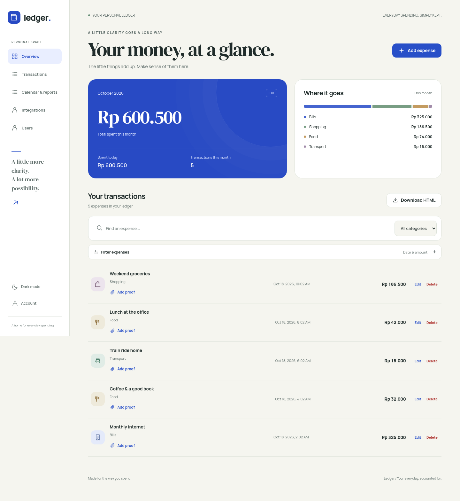
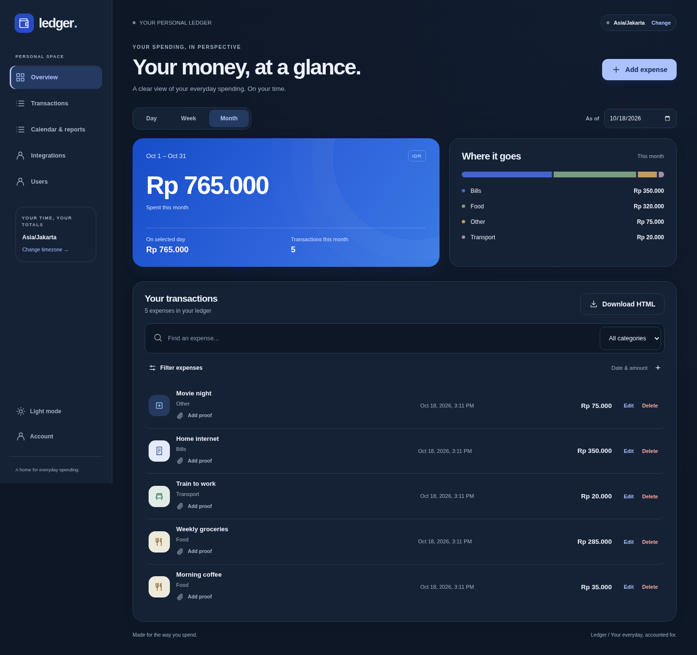
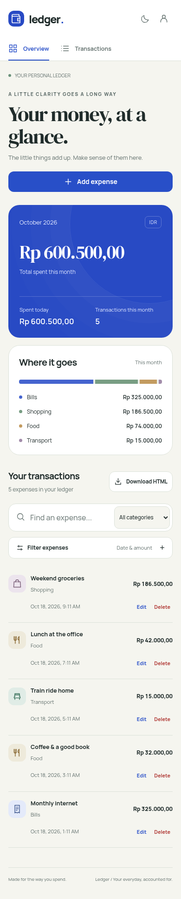
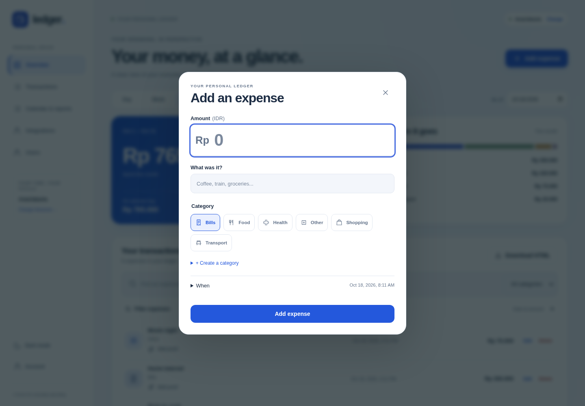

# Finbot / Ledger

A personal expense tracker with a redesigned **Ledger** dashboard: monthly spending, real category totals, searchable transactions, and a focused add/edit dialog. Warm light and deep teal dark themes use locally served Manrope and DM Serif Display fonts.

The dashboard uses the same authenticated **REST v1** contracts as external integrations. Each account owns its expenses, categories, receipt proofs, monthly limit, source IDs, and integration tokens. Calendar, PDF reporting, and receipt upload/retry remain available through **Calendar & reports**. Integrations and administrator-only user management are linked from the navigation.

## Screenshots

Captured from the production build using synthetic records in an isolated database.





### Focused expense entry



## Quick start

Requires Node.js 20.9+ and npm. SQLite uses a native dependency that may need a compiler toolchain.

```bash
npm install
cp .env.example .env.local
npm run dev -- --hostname 127.0.0.1
```

Open localhost:3000. A fresh database creates `admin` with temporary password `123456`; changing it is mandatory before accessing financial records. New passwords require 8-128 characters including a letter and a number. Administrators can create other accounts from Users.

`DATABASE_PATH` defaults to `data/financial-tracker.db`. Proof files live in `proofs/` beside the database; back up both together. Session signing material is generated and retained in the database; no session-secret environment variable is required. Keep the service private unless HTTPS and network access controls are configured.

```bash
npm run build
npm start -- --hostname 127.0.0.1
```

## Using Ledger

- Add/edit in a focused dialog; failed saves retain your draft.
- Search descriptions or categories, select a category, and expand date/amount filters. Results display eight per page; HTML export includes all matching results.
- Monthly overview and category totals cover the browser's local month, independent of transaction filters.
- Attach receipts from a transaction row, or attach files during entry on Calendar & reports. Up to three JPEG/PNG/WebP/PDF files per expense, 5 MiB each.
- Deletion permanently removes proof files and source mappings. Dashboard Undo is offered only for records without proofs and creates a new record/ID; it does not restore integration source IDs.
- Calendar & reports provides the existing calendar and PDF export. Its search/date filters are separate from dashboard filters; PDF dates use inclusive Asia/Jakarta days.
- Integrations manages user-owned categories, recurring monthly spending limits, and tokens. Each new user starts with Food, Transport, Bills, Shopping, Health, and Other.

See [product behavior](docs/product-and-dashboard.md), [security](docs/auth-and-security.md), and [verification](docs/development-and-verification.md).

## Connect an LLM agent

Expense Tracker is the **system of record**, not a chat bot or OCR service. The agent owns message intake, interpretation, authorized-user checks, optional photo understanding, and replies. It must write through the API/MCP and use returned numbers—not generate totals itself.

For a message `Seblak 10.000`, a successful agent extracts `Seblak` / `Food` / IDR 10,000, sends `amountCents: 1000000`, and uses the message timestamp converted to ISO UTC. The adapter may include an optional stable `sourceId` when transport metadata is already available; otherwise it omits it and never asks the user. The agent then formats the returned expense ID and budget snapshot as a chat reply.

```text
Chat message → authorized agent → POST /api/v1/expenses or MCP create_expense
                                      ↓
                    { expense, replayed, budget }
                                      ↓
                    Agent formats the confirmed reply
```

Start here:

1. Set a monthly limit on [Integrations](http://localhost:3000/integrations), if wanted. No limit is configured by default.
2. Generate an integration token there and store it in the agent's secret store, or log in through `POST /api/auth/login` and use its short-lived, revocable JWT. Both credentials act only on their user's records. Send `Authorization: Bearer <TOKEN>` to `/api/v1/*` or `/mcp`; never put a token in a URL, prompt, screenshot, log, or commit. The browser keeps its login JWT in an HttpOnly cookie and calls the same `/api/v1` routes.
3. Give the agent the strict [MCP end-to-end specification](docs/mcp-end-to-end.md) and, for adapter implementation, [the Hermes guide](docs/hermes-agent.md). They cover text/photo flows, categories, clarification, retries, and security boundaries.
4. Restrict the chat adapter to authorized senders. Run it on the same device or through a private authenticated connection; app login does not replace HTTPS or network hardening.

### Agent contract at a glance

| Capability | REST | MCP |
| --- | --- | --- |
| Record and get post-write budget snapshot | `POST /api/v1/expenses` | `create_expense` |
| Replace an expense and recalculate budget | `PATCH /api/v1/expenses/:id` | `update_expense` |
| Permanently delete an expense and proofs | `DELETE /api/v1/expenses/:id` | `delete_expense` |
| Attach, list, and read receipt proof | `/api/v1/expenses/:id/proofs` | `attach_expense_proof`, `list_expense_proofs`, `get_expense_proof` |
| Search and list | `GET /api/v1/expenses?q=&from=&to=` | `list_expenses` |
| Read daily/monthly spending and limit | `GET /api/v1/budget?date=YYYY-MM-DD` | `budget_status` |
| Set or clear recurring limit | `PUT /api/v1/budget` | `set_monthly_limit` |
| List and manage categories | `/api/v1/categories` | `list_categories`, `create_category`, `update_category`, `delete_category` |
| Category summary and PDF tool | — | `expense_summary`, `export_report_pdf` |

The REST create and update bodies require positive integer `amountCents` (IDR minor units), non-blank `description`, a supported `category`, and exact UTC `date` (`YYYY-MM-DDTHH:mm:ss.sssZ`). Create accepts an optional stable `sourceId`; update is a full replacement of those four expense fields. Update and delete return the affected expense plus a recalculated `budget`. Delete is permanent and removes source mappings, proof metadata, and private proof files. `budget` includes Jakarta `date`/`month`, `todayCents`, `monthCents`, `monthlyLimitCents`, signed `remainingCents`, and `exceeded`.

For a receipt, upload one file at a time after creating the expense via token-authenticated multipart `POST /api/v1/expenses/:id/proofs`, or use MCP `attach_expense_proof` with base64 bytes. A proof `sourceId` is optional and should come from adapter metadata when available. List metadata and fetch bytes through the respective proof endpoints/tools. No OCR is performed; the agent may interpret a photo itself before recording the expense.

The MCP endpoint is Streamable HTTP at `http://localhost:3000/mcp`, authenticated by a login JWT or generated Bearer token. Expense and category deletion require `confirm: true`. See the [MCP end-to-end specification](docs/mcp-end-to-end.md) and in-app [API & MCP documentation](http://localhost:3000/docs). The browser uses only `/api/v1` data contracts through its HttpOnly JWT cookie, including `GET /api/v1/reports/pdf`.

Rejected MCP tool calls return JSON text with a stable `code`, readable `error`, suggested `hint`, and `requestId`. The same ID is returned in `X-MCP-Request-ID` and written to the finbot server log as a compact `[mcp]` JSON line without request arguments, file bytes, or credentials.

## Development

```bash
npm test
npm run lint
npm run build
node tests/auth.e2e.mjs
```

The browser suite requires Chromium (`npx playwright install chromium`, or set `PLAYWRIGHT_CHROMIUM_EXECUTABLE_PATH`). It uses a disposable database.

The app uses Next.js, React, and SQLite via `better-sqlite3`. `npm run db:init` initializes or migrates the local schema without erasing existing expenses. Older date-only records remain readable. `budget_settings` holds the recurring limit; `expense_sources` maps chat source IDs to recorded expenses. Tests use isolated in-memory databases. If you switch Node versions after installing dependencies, reinstall or rebuild the native SQLite module for that runtime.

The web UI uses database-backed sessions. API tokens protect the versioned REST endpoints and MCP and inherit the issuing user's ownership scope. Passwords are scrypt hashes, session and API secrets are stored only as hashes, and five failed logins lock an account for 15 minutes.
